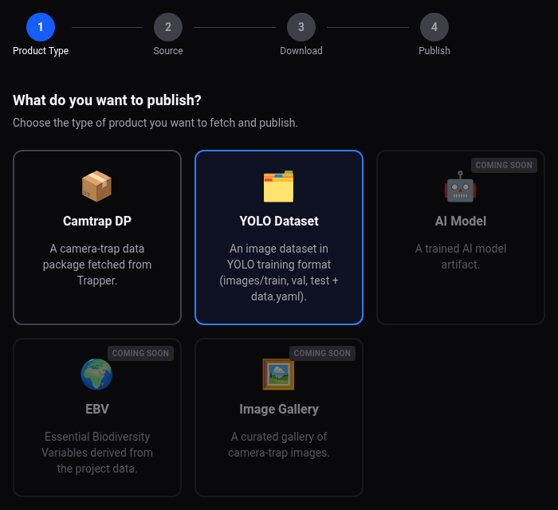
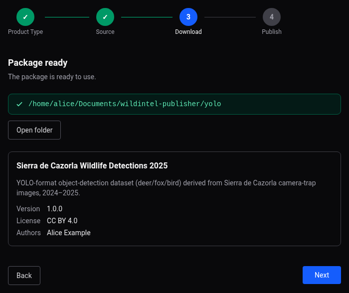

# Web App User Guide — AI Dataset

The `wildintel-publisher` web app makes it easy to publish an AI Dataset (a dataset in
YOLO training format) — a step-by-step wizard, screen by screen, with no commands
involved. See the [Publishing Guide](publishing-guide.md) for the concepts referenced
along the way (media modes, locking, the generic pipeline). Before starting, make sure
every repository account you plan to use is ready — see [Before you
start](guide-web.md#before-you-start).

---

## 1. Choose what to publish

On the wizard's first screen, pick **AI Dataset**.

## 2. Select the folder and check the dataset

A YOLO dataset is never fetched from Trapper: it is a folder already on this computer. This
step has three parts, like the folder step of wildintel-uploader.

1. **Select the folder.** Type the path or use **Browse…**. Your original folder is never
   modified: the app works on a copy of `data.yaml`, and the images and labels stay where they
   are. The app then reads the structure and lists each requirement: that `data.yaml` is there
   and valid, that the splits point to `images/<split>` and the classes are listed, that `nc`
   matches the declared classes, that the splits have images, and that the label files are well
   formed. Anything wrong is shown with its reason.
2. **Choose the checks.** Deeper checks over every image and label file, each one set to
   **Skip**, **Warn** (shows the problems but lets you continue) or **Must pass** (blocks you
   until it passes):
    - every image has a label file;
    - every label file has an image (no orphan labels);
    - every declared class appears in the labels;
    - every label uses a declared class.
3. **Results.** How each check went, with the list of what failed it, and a link to download
   the report. **Continue** goes on to the description of the dataset.

## 3. Confirm the package and its description

The metadata step is made of steps, like the folder step: **1. What are you publishing?**
and, last, **Review metadata**. Each stays locked until the one before it is done; once it is,
it shows a summary of what you answered and a pencil to change it.

**New dataset or new version?** The first step asks it with two cards: *New dataset* (a new
record is created in each repository) and *New version of an existing dataset* (the existing
records are linked to their new versions). **Continue** goes on.

For a **new dataset** the next step is the metadata. For a **new version** there is one more,
**2. Find the previous publication**: choose the repository where it was published (Hugging Face
Hub, Zenodo or B2SHARE), type its identifier — or pick it from what you already published there
(**List what I published here**, using the saved credentials) — and press **Find previous
publication**. The wizard finds the rest through the links the earlier publish left between the
repositories, always picking each record's latest version, and lists what it found with a
*Found* badge. It then suggests the next version number (and refuses one that isn't newer than
the last published one), and pre-fills every repository's form: the same Hugging Face Hub
repository, and the Zenodo/B2SHARE record to create the new version from. For a new dataset,
those fields are hidden instead, and the Hugging Face Hub form warns if the repository you type
already exists.

The last step, **Describe your dataset**, is a form in cards. *What we found in your dataset*
is read from your files (classes and images per split) and can't be changed. The rest is
yours: *About the dataset* (title, description, version, homepage), *License*, *Authors*,
*Publisher and rights holder* and, optionally, *Funding and acknowledgements*. Each card gets
a green tick once it is complete. Title and description are required to continue, together with
a license, a version and at least one author.

The name of an author, the publisher and the rights holder are text fields that suggest the
known ones as you type (those saved in the settings), but accept anything. Picking a known
author fills in their organization; picking a known organization fills in its website and
email. Authors can be reordered by dragging them or with the arrows: they are cited in that
order.

A row of chips above each step's heading recalls what was chosen in the steps before it.
There is no separate "package" step for an AI dataset: **Continue** saves the metadata to the
working copy and goes straight on to choosing the repositories. The images and labels are
copied only when you publish.

## 4. Choose repositories and publish order

**Zenodo** is mandatory here — pre-selected and not deselectable, since its DOI is always
the one used to cite the dataset. **Hugging Face Hub** and **B2SHARE** stay optional
alongside it; GBIF isn't offered at all for this product type, see [Publishing to
GBIF](publishing-gbif.md#4-what-can-i-publish-here). If you add Hugging Face Hub and/or
B2SHARE on top of Zenodo, a **publish order** list lets you reorder them: the first
repository publishes the local dataset itself, and each next one publishes whatever the
previous one wrote to its own output — so, for example, publishing to Hugging Face Hub
before Zenodo lets Zenodo's record link back to it. A YOLO dataset's images always travel
together with `data.yaml` — there's no external repository for them to link to instead
the way Camtrap DP can, so the repository forms don't offer a Mirror/Link choice at all:
Hugging Face Hub gets `data.yaml`, `images/` and `labels/` as loose files, and Zenodo and
B2SHARE get them bundled into a single `yolo.zip`.

A YOLO publication works like a pipe: each repository hands the next one what it needs, and the
last one hands nothing on — it gets no output folder. The DOI and the record's address are in the
publication's report (*Reports*). Between repositories nothing is copied: the images stay in your
dataset's folder, and what travels is just `data.yaml`, the extra files and the folder to read the
images from. The "Sync DOI"/"Sync PID" forms of the last screen don't need an output folder either:
they read the DOI or PID from the Zenodo/B2SHARE record itself (you give the environment and the
record id, or pick it from the list of what you published there).

This is the same mandatory-repo mechanic used for [Software
Application](guide-web-software.md#4-choose-repositories) (Zenodo there too), just with
Hugging Face Hub and B2SHARE still available alongside it here.

## 5. Configure each selected repository

The wizard walks through your selected repositories one at a time, each with its own
configuration form — see that repository's own page for the full form, field-by-field,
with a screenshot: [Hugging Face Hub](guide-web-hfh.md), [Zenodo](guide-web-zenodo.md),
[B2SHARE](guide-web-b2share.md).

## 6. The primary DOI

Hugging Face Hub never has a DOI of its own, so its citation file cites another
repository's as *primary*: always Zenodo's (mandatory for this product type), with
B2SHARE's, if selected too, added as an alternate identifier. Unlike Camtrap DP, there's
no question to answer here.

## 7. Confirm and publish

After a final summary screen, **Publish** runs the whole sequence on its own: uploading
to every selected repository, cross-referencing whatever DOIs Zenodo/B2SHARE obtained
into each other's (and Hugging Face Hub's) citation file, then locking each repository —
with a single live progress view showing every repository's status as it goes.

## 8. When it's done

The wizard confirms which repositories were published, but doesn't print each one's
resulting URL/DOI/PID directly on this screen — check the repository itself or the
publication's report (*Reports*).
If Zenodo and/or B2SHARE were published without Hugging Face Hub in the same run, you
can also use the **Sync DOI**/**Sync PID** sections shown here — besides reflecting the DOI/PID into an already-published Hugging
Face Hub export, they confirm success with a direct link back to it (see
[Zenodo](guide-web-zenodo.md#sync-doi-to-hugging-face-hub)/
[B2SHARE](guide-web-b2share.md#sync-piddoi-to-hugging-face-hub)). If B2SHARE is still
pending moderator review, that's shown too — its final PID/DOI won't be known until a
moderator approves the submission, which happens outside this wizard run.

This screen looks the same as [Camtrap DP's](guide-web-camtrapdp.md#7-when-its-done),
minus the GBIF entry in the "Published to" list.
