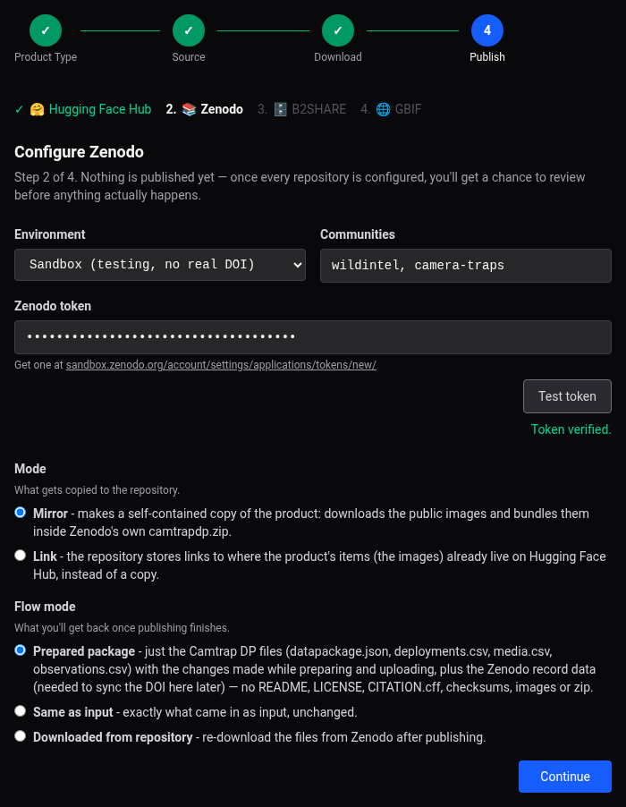
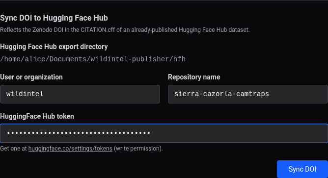
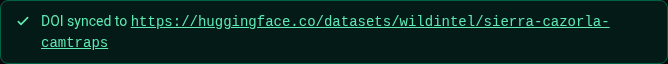

# Web App User Guide — Zenodo

!!! note
    See [Publishing to Zenodo](publishing-zenodo.md) for what this repository is and what
    ends up stored there.

Every time you publish a product to Zenodo, a page similar to this one appears, asking
you to fill in the following fields:

## Fields

- **Environment** — **Sandbox** (`sandbox.zenodo.org`, testing, no real DOI) or
  **Production** (`zenodo.org`).
  The token and the communities for that environment come from the Settings page; a link
  under the field opens it, and Continue stays disabled while the chosen environment has no
  token saved. Nothing about them is typed here.
- **Mode** — **Mirror** (default) downloads the public images and bundles them inside
  Zenodo's own `camtrapdp.zip` (self-contained). **Link** doesn't download anything — the
  repository stores links to where the images already live on Hugging Face Hub instead
  (only meaningful if Hugging Face Hub precedes Zenodo in the publish order).
    - For Camtrap DP in **Mirror** mode, a **Resize images to fit the archive size
      limit** checkbox appears (checked by default) — if the downloaded images would
      push `camtrapdp.zip` over Zenodo's own 50 GiB per-file upload cap, they're all
      downscaled uniformly (same scale for every image, computed once) before bundling.
      **Archive size limit (GiB)** overrides that cap (leave blank for the real 50 GiB
      one), and **Minimum image edge (px)** sets the floor an image's longest edge is
      never shrunk below (640px by default) — past that point, publishing fails with a
      clear error instead of silently producing an unusable image or a still-oversized
      zip. See [Zenodo — Camtrap
      DP](publishing-zenodo-camtrapdp.md#keeping-camtrapdpzip-under-zenodos-own-size-limit).
- **Flow mode** — what you get back once publishing finishes, only relevant if another
  repository comes after this one in the publish order: the **prepared** package plus the
  Zenodo record data needed to sync the DOI later (default) or the **same as input**
  unchanged.

Zenodo reserves its DOI *before* uploading, so it's already known by the time publishing
finishes — see the "When it's done" step of the
[Software Application](guide-web-software.md#7-when-its-done) or
[AI Dataset](guide-web-yolo.md#8-when-its-done) walkthrough for how to see it.

## Sync DOI to Hugging Face Hub

If you publish Zenodo separately from Hugging Face Hub (a different wizard run, or later
after Hugging Face Hub was already published on its own), this section — shown on the
final "All done!" screen once Zenodo has published — reads the DOI from the Zenodo
record itself and reflects it into the `CITATION.cff` and `README.md` of an
*already-published* Hugging Face Hub dataset. Those files are downloaded from the Hub,
edited and uploaded back (with just their lines of `checksums-sha256.txt` updated), so
no local folder is needed and it works from any computer. It's only shown when Hugging Face Hub
isn't part of the same run: when it is, the DOI is already cross-referenced into it
automatically, before its version is tagged.

- **Environment** and **Zenodo record ID** — the record whose DOI is synced. The environment
  comes from `settings.toml` and the ID is pre-filled from the record just published; after a
  different run, type it or use **List what I published there**.
- **User or organization** — pre-filled from `settings.toml`, same as the Hugging Face
  Hub form itself.
- **Repository name** — **never pre-filled** — the dataset name is specific to each
  product, not something worth remembering globally, so type it in each time.
- **HuggingFace Hub token** — leave blank to reuse a previously saved one.

Once synced, it confirms with a direct link to the Hugging Face Hub dataset:

This is the web equivalent of the CLI's `zenodo sync-doi` — except the CLI works on a local
export folder and tells you to re-run `hfh upload` yourself; here the files are edited in the
Hub repository directly.
