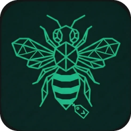

# wildintel-publisher

{ .logo }
{ .logo }

Obtiene paquetes [Camtrap DP](https://camtrap-dp.tdwg.org/) de un proyecto de clasificación de
[Trapper](https://gitlab.com/trapper-project/trapper) y los publica en
[HuggingFace Hub](https://huggingface.co/).

Documentación en construcción.
